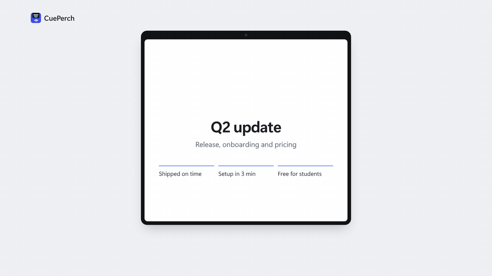
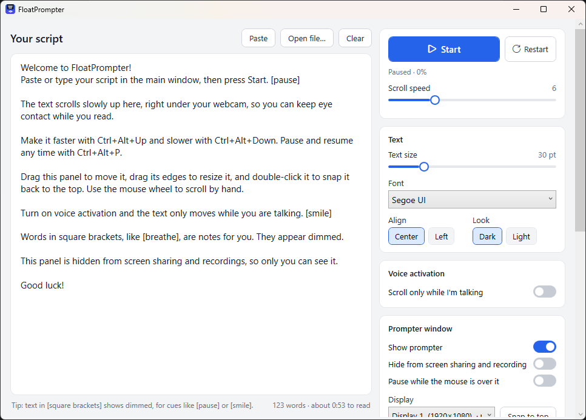

<div align="center">


# FloatPrompter

**A free teleprompter app for Windows 10 and 11, and an open-source alternative to Moody Teleprompter.**

It sits at the top of your screen, right under the webcam, so you can read your notes and still look at the camera. On Windows 10 version 2004 or later, Zoom, Teams, Google Meet, OBS and screen recordings don't pick it up.

[](https://github.com/AnassSaleh/FloatPrompter/releases/latest)
[](#install)
[](LICENSE)


<p>
  <a href="https://github.com/AnassSaleh/FloatPrompter/releases/latest"><b>Download</b></a> ·
  <a href="https://anasssaleh.github.io/FloatPrompter/">Website</a> ·
  <a href="#what-it-does">Features</a> ·
  <a href="#hotkeys">Hotkeys</a> ·
  <a href="#build-from-source">Build</a> ·
  <a href="CONTRIBUTING.md">Contribute</a>
</p>



<sub>The panel and script text are captured from the real app.</sub>

</div>

---

## What it does

The panel docks at the top center of your screen, under the webcam, so your eyes stay close to the camera while you read. On Windows 10 version 2004 or later it's also hidden from screen sharing and recordings, so people watching on Zoom, Teams, Meet, Discord or OBS see neither the prompter nor the window with your script in it. If Windows won't hide it on your PC, FloatPrompter shows a warning, and sharing a single app window instead of your whole screen keeps the prompter out of the share. Nothing on screen can hide from a phone camera pointed at it, or from a capture card recording your display output.

Global hotkeys let you change the speed, pause or jump around from whatever app you're in. With voice activation on, the text moves only while you talk and waits when you stop. To do that it only measures how loud your microphone is, on your PC. The audio is never recorded, saved or sent anywhere.

The whole thing is one `.exe` of about 110 KB. There's no installer and no account, it never goes online, and it doesn't track you. It's MIT-licensed, so it stays free.

## Screenshot

<div align="center">


<sub>The main window, where you paste your script and set the speed, text size, font, look, voice activation and where the prompter sits.</sub>
</div>

## Install

Download **FloatPrompter.exe** from the [latest release](https://github.com/AnassSaleh/FloatPrompter/releases/latest) and double-click it. Nothing else needs installing.

> [!NOTE]
> The first time you run it, Windows SmartScreen may show "Windows protected your PC". Click **More info**, then **Run anyway**. You see this because the app isn't code-signed.

## Use

1. Paste or type your script in the main window, or load one with **Open file...**.
2. Press **Start**, and the text scrolls up in the panel at the top of your screen.
3. Drag the panel to move it and drag its edges to resize it. Double-click it to snap it back under the webcam.

Anything in `[square brackets]`, like `[pause]` or `[smile]`, shows up dimmed, so you can leave yourself cues.

## Hotkeys

These work from any app.

| Keys | Action |
|---|---|
| <kbd>Ctrl</kbd> + <kbd>Alt</kbd> + <kbd>P</kbd> | Play / pause |
| <kbd>Ctrl</kbd> + <kbd>Alt</kbd> + <kbd>↑</kbd> / <kbd>↓</kbd> | Faster / slower |
| <kbd>Ctrl</kbd> + <kbd>Alt</kbd> + <kbd>←</kbd> / <kbd>→</kbd> | Jump back / forward |
| <kbd>Ctrl</kbd> + <kbd>Alt</kbd> + <kbd>R</kbd> | Back to the start |
| <kbd>Ctrl</kbd> + <kbd>Alt</kbd> + <kbd>H</kbd> | Show / hide the prompter |
| <kbd>Ctrl</kbd> + <kbd>Alt</kbd> + <kbd>V</kbd> | Voice activation on / off |

Your script and settings save automatically to `%APPDATA%\FloatPrompter`.

## At a glance

| | FloatPrompter |
|---|---|
| Price | Free |
| Source code | Open, MIT license |
| Hidden from screen sharing | Yes, on Windows 10 version 2004 or later |
| Voice-activated scrolling | Yes, included |
| Works offline, no account | Yes |
| Size | One ~110 KB `.exe`, no installer |

## Build from source

```powershell
powershell -ExecutionPolicy Bypass -File build.ps1
```

It uses the C# compiler that comes with Windows, so you don't need an SDK. The exe ends up in `dist\FloatPrompter.exe`.

Tests live in `tests\`: `run-tests.ps1` drives the real app through UI Automation, and `run-voice-test.ps1` checks voice detection.

## Changelog

Changes for each version are in [CHANGELOG.md](CHANGELOG.md).

## Contributing

Bug reports, ideas and pull requests are all welcome. [Open an issue](https://github.com/AnassSaleh/FloatPrompter/issues/new/choose), or read [CONTRIBUTING.md](CONTRIBUTING.md) if you want to send code.

If FloatPrompter is useful to you, starring the repo helps other people find it.

## License

[MIT](LICENSE), so you can use it, change it and share it.

<sub>FloatPrompter is an independent project and is not affiliated with or endorsed by Moody or any other teleprompter vendor. Product names are used only for comparison.</sub>

<sub>Keywords: teleprompter for Windows, teleprompter app for Windows 10 and 11, free teleprompter, open source teleprompter, Moody Teleprompter alternative, Moody Teleprompter for Windows alternative, autocue for PC, video call teleprompter, Zoom teleprompter, Microsoft Teams teleprompter, Google Meet teleprompter, OBS teleprompter, invisible teleprompter, teleprompter hidden from screen share, webcam teleprompter, eye contact teleprompter, voice activated teleprompter, script reader for presentations.</sub>
