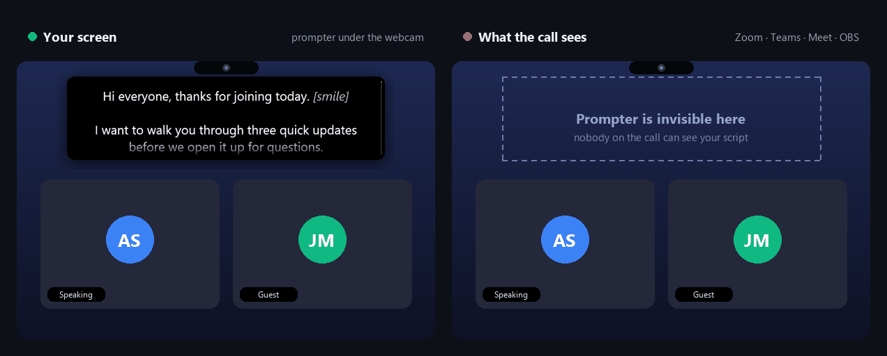

<div align="center">


# FloatPrompter

**A free, open-source floating teleprompter for Windows. An open-source alternative to Moody Teleprompter.**

It sits right under your webcam so you keep eye contact while you read, and it's invisible to Zoom, Teams, Google Meet, OBS and screen recordings.

[](https://github.com/AnassSaleh/FloatPrompter/releases/latest)
[](#-install)
[](LICENSE)


<p>
  <a href="https://github.com/AnassSaleh/FloatPrompter/releases/latest"><b>Download</b></a> ·
  <a href="#-why-floatprompter">Features</a> ·
  <a href="#%EF%B8%8F-hotkeys-work-in-any-app">Hotkeys</a> ·
  <a href="#%EF%B8%8F-build-from-source">Build</a> ·
  <a href="CONTRIBUTING.md">Contribute</a>
</p>



<sub>Left: what you see. Right: what everyone on the call sees.</sub>

</div>

---

## ✨ Why FloatPrompter

- 🎥 **Eye contact on calls.** The panel docks at the top-center of your screen, right under the webcam.
- 🙈 **Hidden from screen share.** Viewers on Zoom, Teams, Meet, Discord, OBS or a recording never see the prompter or your script window. Only you do.
- 🎙️ **Voice activation.** The script scrolls only while you're talking and waits when you stop.
- ⌨️ **Global hotkeys.** Control speed, pause and position from any app without switching windows.
- 🪶 **Tiny and portable.** One ~110 KB `.exe`. No installer, no account, no internet, no tracking.
- 🆓 **Free forever.** MIT-licensed and open source.

## 🖼️ Screenshots

<div align="center">


<sub>The main window: paste your script, set speed, text size, font, look, voice activation and where the prompter sits.</sub>
</div>

## 📥 Install

1. Download **FloatPrompter.exe** from the [latest release](https://github.com/AnassSaleh/FloatPrompter/releases/latest).
2. Double-click it. That's it.

> [!NOTE]
> The first time, Windows SmartScreen may say "Windows protected your PC". Click **More info**, then **Run anyway**. The app isn't code-signed, so this is expected.

## 🚀 Use

1. Paste or type your script in the main window (or **Open file...**).
2. Press **Start**. The text scrolls up in the panel at the top of your screen.
3. Drag the panel to move it, drag its edges to resize it, double-click it to snap it back under the webcam.

Words in `[square brackets]`, like `[pause]` or `[smile]`, show dimmed so you can leave yourself cues.

## ⌨️ Hotkeys (work in any app)

| Keys | Action |
|---|---|
| <kbd>Ctrl</kbd> + <kbd>Alt</kbd> + <kbd>P</kbd> | Play / pause |
| <kbd>Ctrl</kbd> + <kbd>Alt</kbd> + <kbd>↑</kbd> / <kbd>↓</kbd> | Faster / slower |
| <kbd>Ctrl</kbd> + <kbd>Alt</kbd> + <kbd>←</kbd> / <kbd>→</kbd> | Jump back / forward |
| <kbd>Ctrl</kbd> + <kbd>Alt</kbd> + <kbd>R</kbd> | Back to the start |
| <kbd>Ctrl</kbd> + <kbd>Alt</kbd> + <kbd>H</kbd> | Show / hide the prompter |
| <kbd>Ctrl</kbd> + <kbd>Alt</kbd> + <kbd>V</kbd> | Voice activation on / off |

Your script and settings save automatically to `%APPDATA%\FloatPrompter`.

## 🆚 FloatPrompter vs. paid teleprompter apps

| | FloatPrompter | Typical paid apps |
|---|:---:|:---:|
| Price | **Free** | Subscription / one-time fee |
| Open source | ✅ | ❌ |
| Hidden from screen sharing | ✅ | Varies |
| Voice-activated scrolling | ✅ | Often paid tier |
| Works offline, no account | ✅ | Varies |
| Install size | ~110 KB | 50–200 MB |

## 🛠️ Build from source

```powershell
powershell -ExecutionPolicy Bypass -File build.ps1
```

This uses the C# compiler that ships with Windows, so no SDK is needed. The output goes to `dist\FloatPrompter.exe`.

Tests live in `tests\`: `run-tests.ps1` drives the real app through UI Automation, and `run-voice-test.ps1` checks voice detection.

## 🗺️ Changelog

See [CHANGELOG.md](CHANGELOG.md) for what changed in each version.

## 🤝 Contributing

Bug reports, ideas and pull requests are welcome. [Open an issue](https://github.com/AnassSaleh/FloatPrompter/issues/new/choose) or read [CONTRIBUTING.md](CONTRIBUTING.md) to get started.

If FloatPrompter helps you, a ⭐ helps other people find it.

## 📄 License

[MIT](LICENSE). Free to use, change and share.

<sub>FloatPrompter is an independent project and is not affiliated with or endorsed by Moody or any other teleprompter vendor. Product names are used only for comparison.</sub>

<sub>Keywords: teleprompter for Windows, free teleprompter, open source teleprompter, Moody Teleprompter alternative, video call teleprompter, Zoom teleprompter, Teams teleprompter, invisible teleprompter, screen share hidden teleprompter, webcam teleprompter, script reader.</sub>
